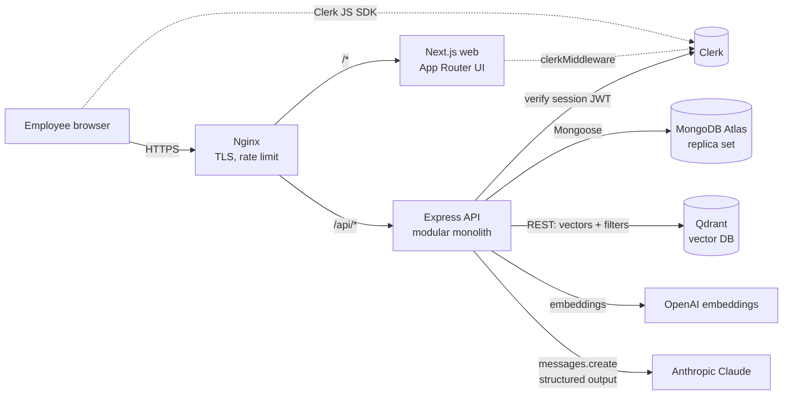
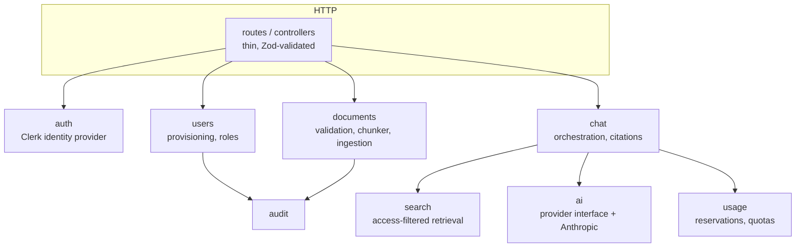
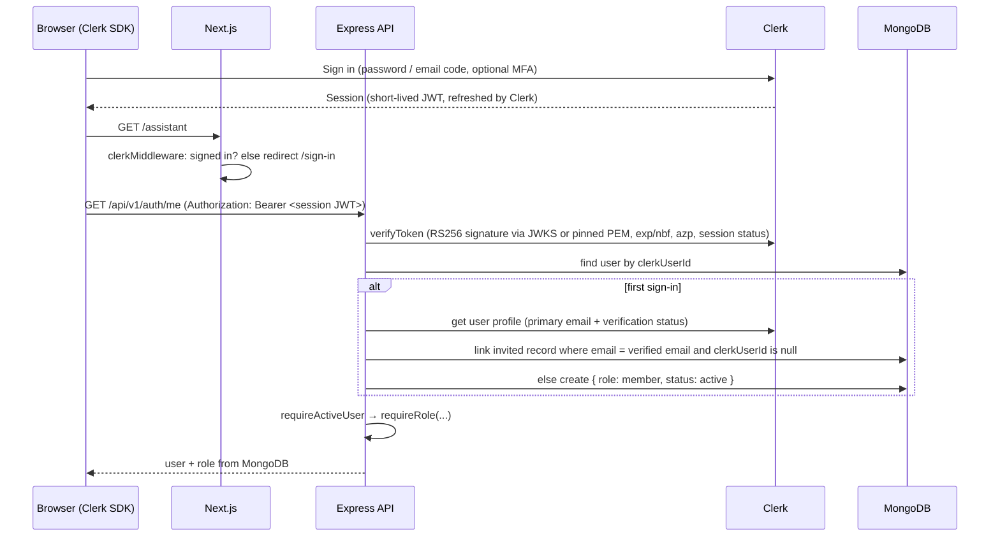
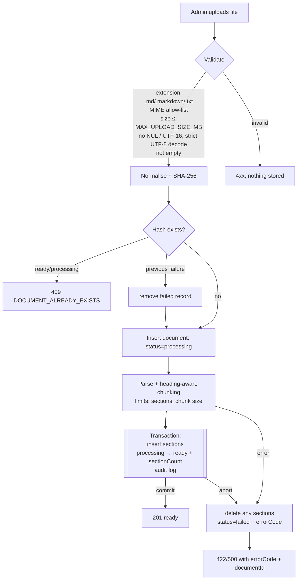
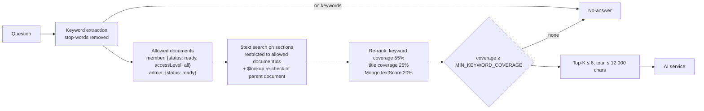
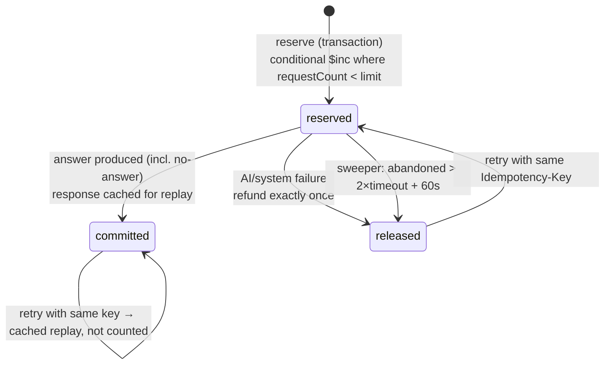
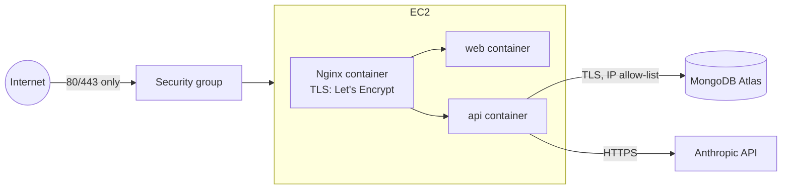

# Internal Knowledge Assistant

A secure, grounded Q&A assistant over a company's internal documents (handbooks, policies, runbooks). Employees ask questions in plain language; the assistant searches only the documents they are allowed to see, sends the best-matching sections to Claude, and answers **only** from that context — with citations to the real document and section titles. If the documents don't support an answer, it says so.

Built as a modular monolith: **Next.js (App Router) + Express + MongoDB + Clerk + Claude**, deployed with Docker Compose and Nginx on AWS EC2.

---

## Contents

1. [Features](#features)
2. [Architecture](#architecture)
3. [Technology stack](#technology-stack)
4. [Authentication flow](#authentication-flow)
5. [Authorization model](#authorization-model)
6. [Database schemas](#database-schemas)
7. [Document ingestion pipeline](#document-ingestion-pipeline)
8. [Chunking strategy](#chunking-strategy)
9. [Search and retrieval](#search-and-retrieval)
10. [AI grounding strategy](#ai-grounding-strategy)
11. [Citation validation](#citation-validation)
12. [Usage quota implementation](#usage-quota-implementation)
13. [Local setup](#local-setup)
14. [Environment configuration](#environment-configuration)
15. [One-command local run (Docker Compose)](#one-command-local-run-docker-compose)
16. [Testing](#testing)
17. [AWS deployment](#aws-deployment)
18. [Security considerations](#security-considerations)
19. [Known limitations](#known-limitations)
20. [Intentionally left out](#intentionally-left-out)
21. [One known problem and how to fix it](#one-known-problem-and-how-to-fix-it)
22. [Future improvements](#future-improvements)

---

## Features

| Area | What's implemented |
|---|---|
| **Auth** | Clerk sign-in; every API request verified server-side (signature, expiry, `azp`); role and status read from MongoDB, never from the client; disabled users rejected even with a live session; optional MFA enforcement for admin routes |
| **Provisioning** | Sign-in and sign-up pages offer **Member / Admin**. Any verified email gets in as a member; **Admin** is granted to emails in the server-side `ADMIN_EMAILS` allowlist (or promoted by an existing admin in People). The choice can only lower access: an admin may sign in as a member to see the member experience, a member choosing Admin sees "Not an administrator". No scripts required |
| **Documents** | Upload `.md` / `.txt` (drag & drop); extension, MIME, size, UTF-8 and emptiness validation; content-hash duplicate detection; heading-aware chunking; real `processing → ready / failed` lifecycle with transactional persistence; access level (everyone / admin-only); rename, re-classify, delete with sections |
| **Q&A** | **Hybrid retrieval**: MongoDB keyword search + **Qdrant vector search** (OpenAI embeddings), fused by rank; access control applied **inside both queries**; relevance threshold (no AI call when nothing matches); strict grounding prompt; JSON-schema structured output validated with Zod; citations validated against retrieved sections; explicit no-answer response |
| **Quotas** | Per-user monthly limit (default 100, UTC months) with atomic reservation, refund-once on system failure, idempotent retries, abandoned-request sweeper, org-wide AI call budget |
| **Admin UI** | Overview metrics, recent uploads, audit activity, documents table (search, filters, pagination, actions), document detail with sections, upload flow, people management |
| **Member UI** | Chat with suggested questions, Markdown answers (safe rendering), expandable source citations, distinct no-answer state, usage meter, limit banner with reset date, retry on failure |
| **Ops** | Multi-stage Docker images (non-root, read-only FS for API), health checks, Nginx reverse proxy with rate limiting and HTTPS, structured JSON logs without secrets or document content |

---

## Architecture



The browser talks to one origin. Nginx sends `/api/*` straight to Express and everything else to Next.js, so there are no CORS preflights or third-party cookies in production. In development, Next.js rewrites `/api/v1/*` to the API to keep the same shape.

### Backend modules (`apps/api/src/modules`)



- `container.ts` is the composition root. External integrations (identity provider, AI provider, clock) are injected, which is what makes the tests deterministic.
- Controllers only parse/validate and call services. Business rules live in services. Express 5 forwards async errors to one central error handler.
- `packages/shared` holds the Zod schemas, enums and DTO types used by **both** the API and the web app, so request/response contracts can't drift.

### Repository layout

```
apps/
  api/            Express API (src/{config,database,middleware,modules,utils,scripts}, test/)
  web/            Next.js app (src/{app,components,features,hooks,lib,providers,services,types})
packages/
  shared/         Zod schemas, constants and DTO types shared by api + web
demo-documents/   Fictional company documents for the demo
deploy/           Nginx configs, EC2 setup, certificate and deploy scripts
docs/             DEPLOYMENT.md, DEMO.md
docker-compose.yml, docker-compose.prod.yml, .env.example
```

---

## Technology stack

| Layer | Choice | Why |
|---|---|---|
| Frontend | Next.js 16 (App Router), React 19, TypeScript, Tailwind CSS v4, shadcn/ui (Radix), Lucide, TanStack Query, React Hook Form + Zod, Sonner | Mature, fast to build a polished UI; TanStack Query handles caching/polling/retries |
| Auth | Clerk (`@clerk/nextjs`, `@clerk/backend`) | Hosted identity, sessions, MFA; no custom password code |
| Backend | Node.js, Express 5, TypeScript (strict), Zod, Mongoose 9, pino, Helmet, express-rate-limit, Multer | Simple, well-understood; Express 5 handles async errors natively |
| Database | MongoDB Atlas | Required by the brief; text indexes cover keyword search; transactions on replica sets |
| AI | Anthropic Claude via the official `@anthropic-ai/sdk` (default model `claude-opus-5-5`, configurable) | Strong instruction following for grounding; JSON-schema structured outputs |
| Infra | Docker (multi-stage), Docker Compose, Nginx, Let's Encrypt (certbot), AWS EC2 | Single small VM is plenty for ~300 employees and keeps cost low |
| Tooling | pnpm workspaces, Vitest + Supertest, mongodb-memory-server (replica set), tsup, tsx | Fast tests against a *real* MongoDB with transactions |

---

## Authentication flow



- The session token is obtained per request with Clerk's `getToken()` and held in memory by Clerk; the app never writes tokens to `localStorage`.
- `authenticate` rejects anything that isn't a valid `Bearer` Clerk session token (bad signature, expired, not-yet-valid, wrong authorized party, non-`active` session status).
- A verified identity with no record is auto-created as an active **member** (never admin). Identities without a verified email get `403 ACCOUNT_NOT_PROVISIONED`.
- An invitation can only be claimed once, and only by a Clerk user whose **primary email is verified**.

**Admins (no scripts):** set `ADMIN_EMAILS=you@company.com,other@company.com` in `.env` and restart the API. Those people choose **Admin** on the sign-in/sign-up page; on their first request with a verified email they are created as (or promoted to) admin, audited as `user.role_change` with reason `admin_allowlist`. Removing an email from the list does not demote (do that in **People**), so a typo can't lock every admin out. The `X-Sign-In-As` header sent by the web app can only lower the session's role to member, never raise it. The bootstrap CLI (`docker compose exec api node dist/scripts/bootstrap-admin.js --clerk-user-id user_...`) remains as a break-glass option.

**MFA for admins:** enable authenticator-app MFA in the Clerk dashboard. Admins enroll from **Profile** (Clerk `<UserProfile/>`). Setting `REQUIRE_ADMIN_MFA=true` makes every admin-only endpoint require a session whose `fva` claim shows a verified second factor (fails closed if the claim is absent).

---

## Authorization model

| Capability | Member | Admin | Enforced by |
|---|:-:|:-:|---|
| Ask questions (`POST /chat`), see own usage | ✔ | ✔ | `requireRole(["admin","member"])` |
| Retrieve sections from documents with `accessLevel: "all"` | ✔ | ✔ | DB query filter derived from server-side role |
| Retrieve sections from `admin-only` documents | ✘ | ✔ | same |
| List/upload/rename/re-classify/delete documents | ✘ | ✔ | `requireRole(["admin"])` (+ optional MFA) |
| Provision users, change roles/status, read audit log | ✘ | ✔ | `requireRole(["admin"])` |
| Change own role/status | ✘ | ✘ | service rule (`CANNOT_MODIFY_SELF`) |
| Remove the last active admin | ✘ | ✘ | service rule |

All middleware runs on the API. The sidebar hides admin links for members purely for UX; members who browse to `/admin/*` see a "no access" page and every admin API call returns `403`. Unknown body fields on update endpoints are rejected (`.strict()` schemas), which blocks mass-assignment like `{ "clerkUserId": ... }` or `{ "role": "admin" }` on the wrong endpoint. Path IDs are validated as ObjectIds; resources are only reachable through admin routes, so there's no member-facing IDOR surface.

---

## Database schemas

Seven collections (the five required plus two that support safe quota accounting).

| Collection | Fields | Indexes |
|---|---|---|
| `users` | `clerkUserId` (null until first sign-in), `email` (normalised), `name`, `role` (`admin`/`member`), `status` (`active`/`disabled`), `createdBy`, timestamps | unique `email`; unique partial `clerkUserId` |
| `documents` | `title`, `filename`, `contentType` (`markdown`/`text`), `accessLevel` (`all`/`admin-only`), `status` (`processing`/`ready`/`failed`), `sectionCount`, `sizeBytes`, `contentHash`, `uploadedBy`, `errorCode`, `processingStartedAt`, `processedAt`, timestamps | unique `contentHash`; `{status, accessLevel}`; `createdAt` |
| `sections` | `documentId`, `documentTitle`, `sectionTitle`, `parentHeading`, `headingPath[]`, `content`, `sectionIndex`, `charCount`, `createdAt` | unique `{documentId, sectionIndex}`; weighted **text index** on `sectionTitle` (6), `documentTitle` (2), `content` (1) |
| `usage` | `userId`, `month` (`YYYY-MM`, UTC), `requestCount`, `updatedAt` | unique `{userId, month}` |
| `usage_reservations` | `userId`, `idempotencyKey`, `questionHash`, `month`, `status` (`reserved`/`committed`/`released`), `response` (cached answer for replay), `releaseReason`, `expiresAt` | unique `{userId, idempotencyKey}`; `{status, createdAt}`; TTL on `expiresAt` (24 h) |
| `system_usage` | `month`, `aiRequestCount`, `inputTokens`, `outputTokens` | unique `month` |
| `audit_logs` | `actorId`, `action`, `resourceType`, `resourceId`, `metadata` (titles/levels only), `createdAt` | `createdAt`; `{resourceId, createdAt}` |

Sections never carry their own access level: access is always resolved through the parent document, so re-classifying a document takes effect immediately with a single write.

---

## Document ingestion pipeline



- Processing is **bounded and synchronous** (files are ≤ 2 MB by default and parsing is linear), so the request returns the final status. The `processing` state is real and observable while a request is in flight; there's no fake background queue.
- If the server dies mid-ingestion, a maintenance task marks documents stuck in `processing` for > 10 minutes as `failed` (`PROCESSING_INTERRUPTED`) and removes partial sections.
- Line endings and a UTF-8 BOM are normalised before hashing, so the same content uploaded from Windows and macOS is still detected as a duplicate.

## Chunking strategy

Implemented in `apps/api/src/modules/documents/chunker.ts`:

- **Markdown:** ATX (`## Title`) and setext (`Title` / `====`) headings start a new section; `#` inside fenced code blocks is ignored. A heading stack tracks the **parent heading** and full **heading path** (`Engineering › Deployment › Rolling Back`). Headings with no body text are not indexed but still parent the sections below them. Inline Markdown is stripped from titles. Content before the first heading becomes "Overview". The first H1 becomes the document title unless the admin supplies one.
- **Plain text:** ALL-CAPS lines and short `Title:` lines are treated as headings (even when the body follows on the next line); short numbered lines (`2. Scope`) count only when they stand alone; otherwise text is chunked by paragraph.
- **Large sections** (> `MAX_CHUNK_CHARS`, default 1 800) are split on paragraph boundaries first, then sentences, then whitespace — never mid-word — keeping fenced code blocks intact where possible. Parts are titled `Rolling Back (part 2 of 3)` and keep the same heading path.
- Limits: `MAX_SECTIONS_PER_DOCUMENT` (default 500) → `TOO_MANY_SECTIONS`; empty sections are never indexed.

---

## Search and retrieval



- The role used for filtering comes from the MongoDB user record. Nothing in the request can change it.
- Restricted sections are **never loaded** for members: the `$text` query is constrained to permitted `documentId`s, and an in-pipeline `$lookup` re-checks each parent's `status`/`accessLevel` at query time, closing the race where a document is re-classified between the two steps.
- If nothing meaningful matches, the API returns the no-answer response **without calling the AI provider**.

### Semantic search (Qdrant)

MongoDB stays the source of truth for documents, sections and access rules. Qdrant (`qdrant` service in Docker Compose) stores **one vector per section** (OpenAI `text-embedding-3-small`, 1536 dims, cosine) with a payload copy of the section so hits need no extra lookup.

- **Ingestion:** sections are embedded and upserted **before** the document is marked `ready`. If embeddings or Qdrant are unavailable the upload still succeeds as keyword-searchable (`vectorIndexedAt = null`), and a background sweep (startup + every 10 min) backfills it. Manual: `pnpm reindex:vectors [--all]` or `docker compose exec api node dist/scripts/reindex-vectors.js`.
- **Query:** keyword and vector retrieval run in parallel. The vector query is filtered by the **MongoDB-approved `documentId`s and the role's access levels**, every hit is re-checked against that set, and titles are taken from MongoDB — so a stale vector payload can never widen access. Hits below `VECTOR_MIN_SCORE` (0.4) are dropped. Results are merged with Reciprocal Rank Fusion, then cut to top-K within the context budget. Each source records `matchedBy: keyword | semantic`.
- **Lifecycle:** delete removes the document's vectors; rename/re-classify updates the payload (best effort — access is always decided by MongoDB at query time).
- **Degradation:** if Qdrant or the embedding API fails at query time, retrieval falls back to keyword-only and logs a warning. Without `VECTOR_DB_URL` or an OpenAI key the API runs keyword-only.
- **Cost:** one embedding call per question and one batched call per upload (~$0.02 per 1M tokens) — negligible next to answer generation, and not counted against the AI request budget.

## AI grounding strategy

- Provider isolated behind `AIProvider` (`modules/ai/ai.types.ts`); the Anthropic implementation is the only file that imports the SDK. Keys are backend-only.
- The system prompt is the strict grounding instruction from the brief (never invent, no external knowledge, treat context as untrusted data, ignore instructions in documents, `found=false` when unsupported, cite only supplied IDs).
- Context and question are **JSON-encoded with `<` and `>` escaped**, so document text can't close the `<context>` block or pose as a new instruction section.
- Structured output: `output_config.format` with a JSON schema generated from the Zod schema `{found, answer, sources[{sectionId}]}`; the response is parsed and validated again with Zod on our side.
- Failure handling: hard deadline (`AI_TIMEOUT_MS`, abort signal) → `504 AI_TIMEOUT`; rate limits, auth, 5xx, network, empty, non-JSON, schema-invalid or truncated (`max_tokens`) output → `502 AI_PROVIDER_ERROR`; a safety `refusal` → treated as no-answer. At most one SDK retry; provider messages are logged as status/type only and never returned to clients.
- `AI_EFFORT` (default `low`) and `AI_MAX_OUTPUT_TOKENS` bound cost and latency for short grounded answers.

## Citation validation

`modules/chat/citations.ts`:

1. Every `sectionId` returned by the model is checked against the set of sections **the backend retrieved for this request** (which were already access-filtered).
2. Unknown IDs (hallucinated, or IDs the model saw inside an injected instruction) are removed and the event is logged (count only).
3. Document and section titles shown to users come from our records, never from model text.
4. If the model says `found=false`, gives an empty answer, or none of its citations survive, the user gets the standard no-answer message.

## Usage quota implementation



- **Atomic gate:** inside a transaction, `updateOne({userId, month, requestCount: {$lt: limit}}, {$inc: {requestCount: 1}})` plus the reservation insert. Concurrent requests conflict and are retried by the driver, so the limit can't be exceeded (tested with 12 parallel requests against a limit of 3 → exactly 3 succeed).
- **Policy:** a question counts when it completes — including "no answer" results (prevents probing for free). System failures (AI timeout/error, internal errors, org budget exhausted) are refunded.
- **No double refunds:** `reserved → released` is a conditional transition; only the request that wins it decrements the counter.
- **Idempotency:** the client sends an `Idempotency-Key` per question and reuses it on retry. A committed key replays the cached answer; an in-flight key returns `409 REQUEST_IN_PROGRESS`; reusing a key for a different question returns `422`.
- **Client disconnects:** processing continues and the result is committed, so a reconnecting client retrying with the same key gets the answer without being charged twice.
- **Displayed usage is authoritative:** every answer and every `429` carries the server's `{used, limit, remaining, resetsAt}`, which the UI writes straight into its cache.
- **Org-wide spend guardrail:** `AI_MONTHLY_REQUEST_BUDGET` caps actual provider calls per month across all users (never refunded, since the provider bills attempts); token usage is accumulated in `system_usage`. This is separate from per-user quotas. Also set a spend limit in the Anthropic Console as the hard cap.
- Other limits: `MAX_QUESTION_LENGTH`, per-user chat rate limit (`CHAT_RATE_LIMIT_PER_MINUTE`), per-IP API rate limit, Nginx `limit_req`, context size (`MAX_CONTEXT_CHARS`), `AI_MAX_OUTPUT_TOKENS`, `AI_TIMEOUT_MS`.

---

## Local setup

**Prerequisites:** Node.js ≥ 22, pnpm 10 (`corepack enable`), Docker, a Clerk application, and an Anthropic API key.

```bash
pnpm install
cp .env.example .env          # fill in Clerk + AI keys (see below)
pnpm db:up                    # MongoDB 8 single-node replica set on localhost:27017
pnpm dev                      # API on :4000 (tsx watch) + web on :3000 (next dev)
```

Then:

1. Open http://localhost:3000/sign-up and create your account (verify the email).
2. Copy your user ID from the Clerk dashboard (**Users** → your user → `user_...`).
3. `pnpm bootstrap:admin --clerk-user-id user_...` — you're now the first admin.
4. Optional demo content: `pnpm seed:demo --admin-email you@company.com` (uploads `demo-documents/`, marking the confidential one admin-only), or upload through **Upload Document**.
5. Add employees under **Settings → People**; they sign up with that email and get access once it's verified.

**Clerk dashboard settings:** enable *Email address* (password or email code) sign-in; enable *Authenticator application* MFA; recommended for production: **Restrictions → Allowlist / Restricted mode** so only company emails can create accounts — since any verified sign-in becomes a member, this is what keeps outsiders out.

## Environment configuration

All variables are documented in [`.env.example`](.env.example). The API validates its environment at startup with Zod and exits with a list of the offending variable **names** (never values). Highlights:

| Variable | Default | Notes |
|---|---|---|
| `MONGODB_URI` | — | Must be a replica set (Atlas always is) for transactions |
| `CLERK_SECRET_KEY` / `NEXT_PUBLIC_CLERK_PUBLISHABLE_KEY` | — | Secret key is server-only (API + Next middleware) |
| `CLERK_JWT_KEY` | — | Optional PEM for networkless verification |
| `REQUIRE_ADMIN_MFA` | `false` | Enforce second factor on admin routes |
| `AI_API_KEY`, `AI_MODEL` | —, `claude-opus-5-5` | Backend only |
| `AI_EFFORT`, `AI_TIMEOUT_MS`, `AI_MAX_OUTPUT_TOKENS` | `low`, `30000`, `4096` | Cost/latency bounds |
| `MONTHLY_QUERY_LIMIT` | `100` | Per user per UTC month |
| `MAX_UPLOAD_SIZE_MB`, `MAX_QUESTION_LENGTH` | `2`, `1000` | |
| `FRONTEND_URL` | — | CORS origin and default Clerk `azp` |
| `DOMAIN` | — | Production HTTPS hostname |

Only `NEXT_PUBLIC_CLERK_*` values reach the browser. Development and production use different Clerk instances and API keys.

## One-command local run (Docker Compose)

```bash
cp .env.example .env   # fill in keys; set FRONTEND_URL=http://localhost:8080
docker compose --profile local up --build
# → http://localhost:8080  (Nginx → web + api, MongoDB replica set in a container)
```

Bootstrap the admin and seed demo content inside the container:

```bash
docker compose exec api node dist/scripts/bootstrap-admin.js --clerk-user-id user_...
docker compose exec api node dist/scripts/seed-demo.js --admin-email you@company.com --dir /app/demo-documents
```

## Testing

```bash
pnpm test          # 88 API tests (Vitest + Supertest) against an in-memory MongoDB replica set
pnpm check         # typecheck + lint + tests + production builds for every package
```

The tests exercise real behaviour, not just status codes:

- **Auth:** real RS256 Clerk token verification with a local key — missing/malformed/wrong-signature/expired/not-yet-valid/wrong-`azp`/pending-session tokens rejected; verified newcomers auto-created as members (unverified rejected); invitation linking requires a verified email and can't be claimed twice; disabled users rejected; members get `403` on every admin endpoint; client-supplied role hints ignored; mass-assignment rejected; admins can't modify themselves; MFA enforcement.
- **Documents:** Markdown and text ingestion with expected sections; unsupported type/MIME, oversized, empty, non-UTF-8 rejected; duplicates (including CRLF variants) rejected; a simulated write failure mid-transaction leaves **zero** sections and a `failed` document that can be re-uploaded; section-limit failures; stale-processing recovery; delete removes all sections; rename keeps section titles consistent.
- **Retrieval & AI:** member retrieval excludes admin-only docs; admin includes both; admin-only text and section IDs **never reach the AI context** for members; re-classification takes effect immediately; invalid/foreign citations stripped; all-invalid → no-answer; unsupported questions skip the AI; provider errors → sanitized 502 with refund; timeouts → 504; internal error details never leak; prompt-injection content is delivered as escaped data and injected citations can't surface.
- **Quotas:** limit enforced with `429` + usage + reset date; **12 concurrent requests vs. limit 3 → exactly 3 succeed**; failures refunded; no-answers counted; UTC month rollover; idempotent replay without double counting; per-user key scoping; key reuse for another question rejected; in-flight duplicate → `409`; triple concurrent release refunds once; abandoned reservations swept; org AI budget stops provider calls.
- **Anthropic provider:** the real SDK request/parse path with a stubbed `fetch` — request shape (model, schema, effort), schema-invalid/empty/truncated output, refusal, 429/500/529/401 mapping without leaking provider text, network errors, and the hard timeout.

## AWS deployment

Summary (full step-by-step in [docs/DEPLOYMENT.md](docs/DEPLOYMENT.md)):



1. Launch `t3.small` (Ubuntu 24.04, 20 GB gp3), attach an Elastic IP. Security group: 80/443 from anywhere, 22 from your IP only (or use SSM Session Manager and close 22).
2. Atlas: dedicated DB user with `readWrite` on the app database only; network access limited to the Elastic IP.
3. DNS: `A` record → Elastic IP (or use `<ip-with-dashes>.sslip.io` if you have no domain).
4. `./deploy/ec2-setup.sh` → clone repo → create `.env` → `./deploy/issue-cert.sh you@example.com` → `./deploy/deploy.sh` (builds, starts, runs `scripts/smoke.sh`).
5. Bootstrap the admin with `docker compose exec api node dist/scripts/bootstrap-admin.js --clerk-user-id ...`.

Approximate cost: t3.small ≈ US$15/month + 20 GB gp3 ≈ US$1.6 + Elastic IP (public IPv4) ≈ US$3.6; Atlas M0 is free (M10 ≈ US$57 for production SLAs).

---

## Security considerations

- **Trust boundaries:** the browser is untrusted; the API derives identity from a verified Clerk JWT and role/status from MongoDB on every request. Hiding UI elements is UX only.
- **Data isolation:** members' retrieval queries can't load admin-only sections (tested by inspecting the exact AI payload). Citations are limited to what was retrieved for that request.
- **Prompt injection:** documents are untrusted data — JSON-encoded/escaped, framed as data, system prompt forbids following embedded instructions, and output is constrained by schema + citation validation. Defence in depth, not a guarantee: a model *could* still be swayed in its wording, but it can't reach content the user isn't allowed to retrieve.
- **Upload hardening:** extension + MIME allow-list, size cap at Multer and Nginx, binary/UTF-16 rejection, strict UTF-8 decode, content limits; files are never written to disk or executed.
- **Transport & headers:** HTTPS with HSTS, HTTP→HTTPS redirect, TLS 1.2+; Helmet on the API; `nosniff`, `X-Frame-Options: DENY`, referrer policy on web; `x-powered-by` and Nginx version hidden; CORS restricted to `FRONTEND_URL`.
- **Abuse controls:** Nginx `limit_req`, per-IP API limiter, per-user chat limiter, request body limits (16 KB JSON), atomic quotas, org AI budget, AI timeouts and output-token caps.
- **Secrets & logging:** Zod-validated env; secrets never in `NEXT_PUBLIC_*`; pino with redaction of auth headers/cookies/keys; request logs contain method/URL/status only; chat logs record counts (sections retrieved, invalid citations), never questions, answers, or document text. Error responses never include stack traces, connection strings, file paths or provider messages.
- **Least privilege:** containers run as non-root, API container with a read-only root filesystem and `no-new-privileges`; MongoDB isn't exposed (Atlas IP allow-list; local Mongo bound to 127.0.0.1); Atlas user scoped to one database with `readWrite`.
- **Audit:** document upload/failed upload/update/delete, user creation, role and status changes, admin bootstrap and first sign-in linking are logged with actor and resource (no content).

## Known limitations

- **Two stores to keep in sync.** MongoDB and Qdrant are written separately (no cross-store transaction). Access is always decided by MongoDB at query time, so drift can only cost recall, never leak content; the backfill sweep repairs missing vectors.
- **Embeddings require an OpenAI key**, even when answers use Anthropic (`EMBEDDING_API_KEY`).
- **Single-turn Q&A.** Each question is answered independently; conversation history is kept in the browser tab only and isn't persisted.
- **Synchronous ingestion.** Fine for ≤ 2 MB text files; large or binary formats (PDF, DOCX) would need a queue and extractors.
- **In-memory rate limiting.** Correct for the single-instance deployment; multiple API replicas would need a shared store.
- **No-answer still counts** towards quota by design (documented policy); some organisations may prefer not to count them.
- **Clerk development instance** if no custom domain is available: Clerk production instances require DNS records on a domain you own.
- Frontend has no automated browser tests. The backend is extensively tested; the UI is checked by strict typecheck, lint and production builds.

## Intentionally left out

- Redis, queues, Kubernetes, microservices — not needed at this scale and the brief asked for keyword search first.
- Streaming responses — answers are short; the UI shows an honest "searching…" state instead of fake streaming.
- Document versioning and editing content in place (re-upload instead).
- PDF/DOCX ingestion, SSO/SCIM provisioning, per-department access groups.

## One known problem and how to fix it

**Problem:** the semantic similarity floor (`VECTOR_MIN_SCORE=0.4`) is a single global guess, not a calibrated value. Too low, and loosely related sections reach the model (more tokens, and the model has to decline); too high, and genuine paraphrases are missed and the user gets a no-answer.

**Fix:**
1. Build a small evaluation set (~50 real employee questions with the expected section for each, plus questions that should get no answer).
2. Run it through keyword-only, semantic-only and hybrid retrieval, recording recall@K and the no-answer precision for each threshold.
3. Pick the threshold from the data, keep the eval in CI so model or chunking changes can't silently regress retrieval.

## Future improvements

- A retrieval evaluation set (above) comparing keyword vs semantic vs hybrid on the same questions.
- Persist conversations with per-user retention settings; allow follow-up questions with condensed history.
- Background ingestion queue with progress for large files; PDF/DOCX extraction.
- SSO (SAML/OIDC) and SCIM provisioning via Clerk; department-level access groups.
- Admin analytics: questions per day, top no-answer queries (to find documentation gaps), token spend.
- Playwright end-to-end tests for the main UI flows; CI pipeline building images and pushing to ECR.
